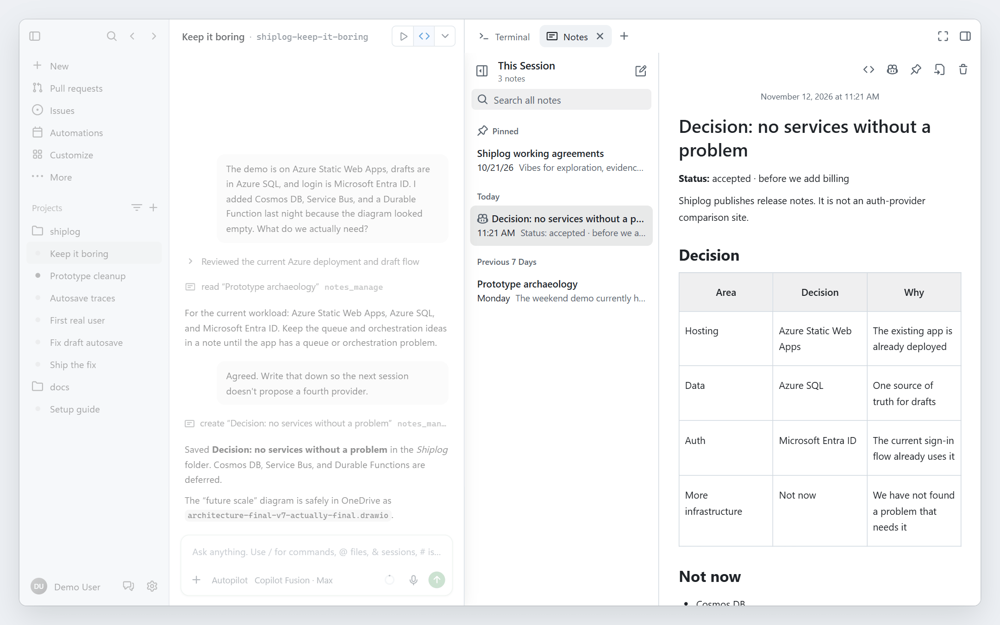
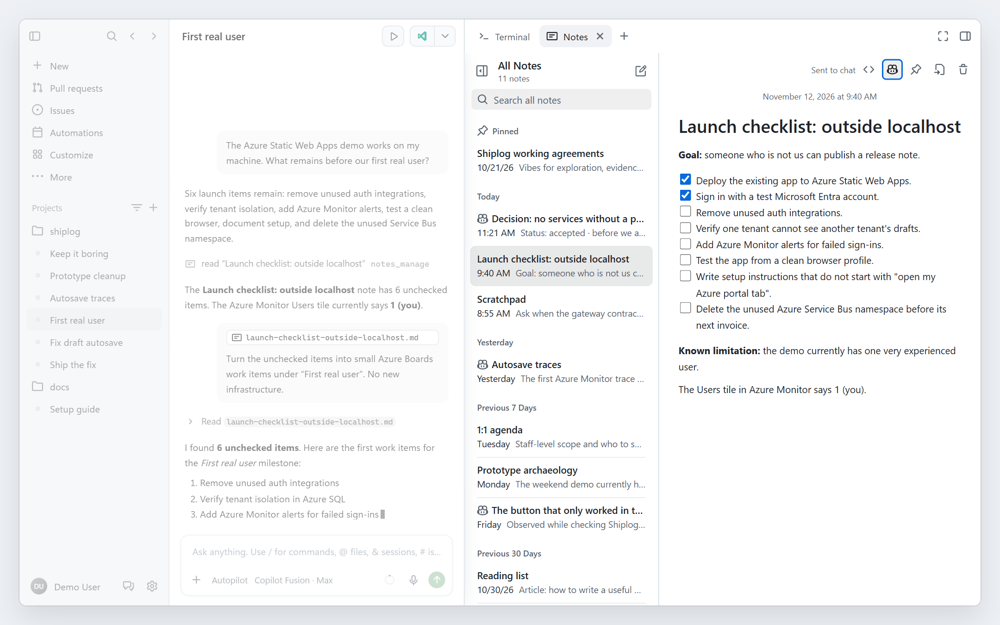
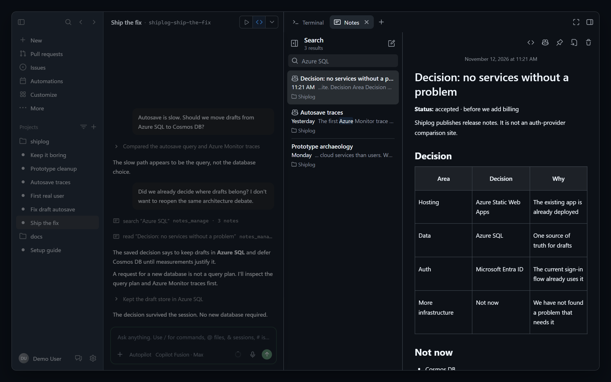
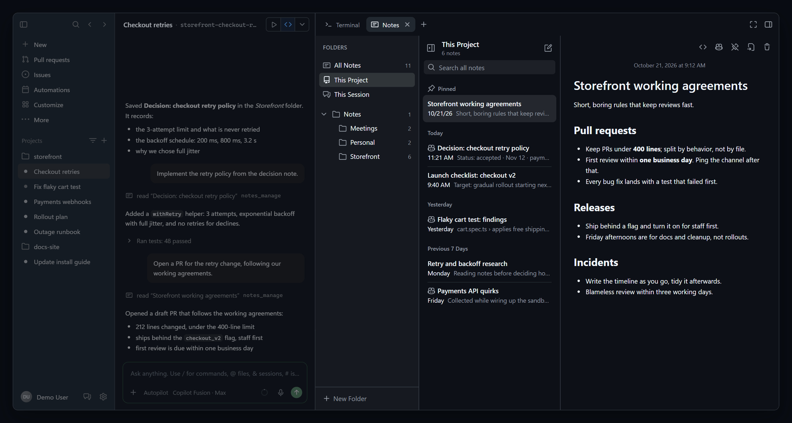
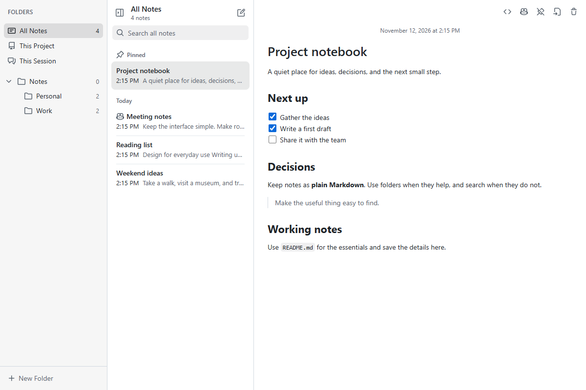
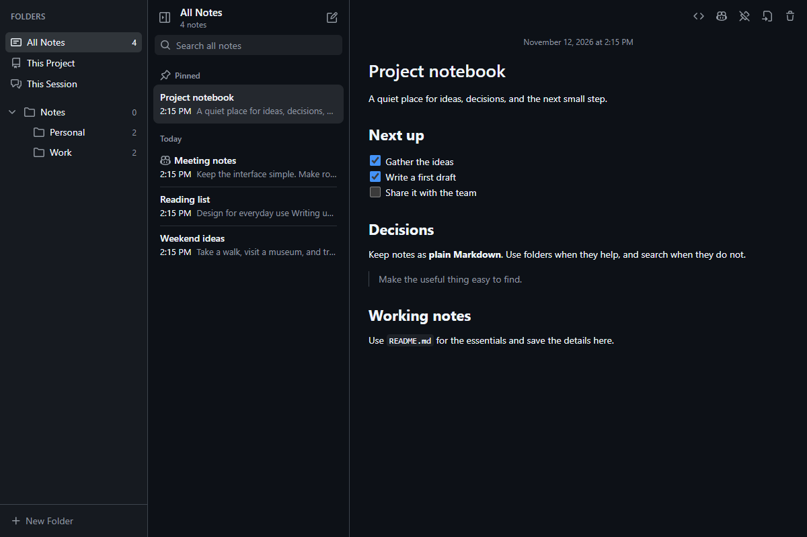
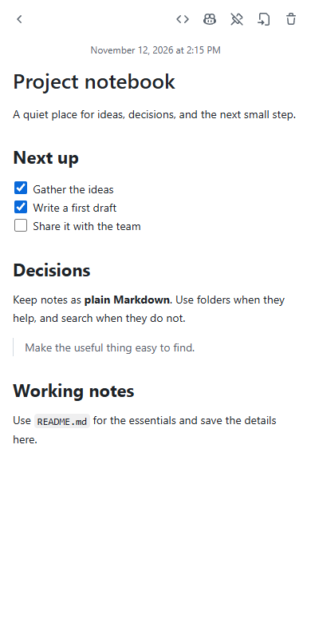

# Notes

Markdown notes for the GitHub Copilot app, with rich and plain editing,
session provenance, live sync, and Ask Copilot. Shipped with the
`agent-plugins` plugin as of 2.2.0.

## Installation

Register the marketplace once, then install the plugin:

```shell
copilot plugin marketplace add filipmares/agent-plugins
copilot plugin install agent-plugins@agent-plugins
```

Update with `copilot plugin update agent-plugins`. Ask Copilot to open the
**Notes** canvas; installing the plugin also makes `notes_manage` available.
For a standalone copy, use **Customize → Extensions → Import canvas from repo**
and choose `filipmares/agent-plugins`, then `extensions/notes/`. Manual imports
do not receive plugin updates; re-import to update that copy.

Native-app interactions remain unverified. See [Verification limits](#verification-limits)
before using the experimental extension for important notes.

## Screenshots

### In context

Notes beside a chat, in four scenes from a fictional Azure-hosted app called
Shiplog. These are **illustrations**, not captures of the native app: the
window frame, sessions sidebar, chat transcript and tool-call rows are a mock-up
(a fictional `contoso/shiplog` project) built around the real Notes panel
running in headless Microsoft Edge on Windows. Notes stays
docked in one continuous window; the surrounding chat and sidebar are faded
to emphasize the panel, not shown as a separate app. The reconstructed composer
shows Autopilot and Copilot Fusion · Max as example UI labels, not required
settings. Every note is synthetic, in a disposable library, and the panel shows its standalone
light/dark fallback colors, not the app's injected theme. In the Ask Copilot
scene the send was a mocked callback: the prompt and attached note shown in the
chat are what the panel sent, while the agent's reply is scripted. No real
notes, sessions, chat turns or OS trash were used.

**Capture decisions while you work.** The agent records why Shiplog is keeping
Azure Static Web Apps, Azure SQL, and Microsoft Entra ID—and deferring extra
services. The decision appears under This Session.



**Turn a launch checklist into work.** Ask Copilot sends the checklist note to
the chat and drafts Azure Boards work items for the first real user.



**Recall an architecture decision.** In another session, the agent checks the
saved choice to keep drafts in Azure SQL before considering Cosmos DB.



**Keep working agreements close.** The expanded project view shows Shiplog's
pinned agreements: “Vibes for exploration, evidence for shipping.”



### The panel on its own

Headless Microsoft Edge on Windows, using synthetic notes in a disposable
library. These show the standalone light/dark fallback colors, not the native
app's chrome or its injected theme. No real notes, chat turns or OS trash were used.







## Panel

Open the `notes` canvas. Optional input targets a `noteId`, `folder`, or
`view` (`all`, `project`, or `session`); `reveal` retargets an open panel.
The panel has three columns (folders, notes, editor). Below 960 px, folders
become an overlay. Below 640 px, one pane is shown at a time.

Colors follow the Copilot app's injected canvas theme tokens and light/dark
mode, with GitHub light/dark defaults when opened outside the host. Folder
icons and selection are neutral; blue is reserved for focus, drop targets,
and informational highlights. The documented canvas contract has no dedicated
sidebar or selection tokens, so those surfaces derive from its foreground
and background tokens rather than depending on app-internal variables.

- Smart views: All Notes, This Project, and This Session. Folders support
  create, rename (double-click), delete with a recursive count, collapse, and
  dragging notes onto a folder to move them. A panel opened without a session
  (see [Opening without a session](#opening-without-a-session)) has no This
  Session view.
- The list groups notes as Pinned, Today, Yesterday, Previous 7/30 Days, and
  then by month and year. Search spans every folder and highlights matches.
  Agent-created notes show a Copilot mark.
- The rich editor supports headings, bold, italic, strike, inline code,
  bullet/ordered/check lists, quotes, unhighlighted code blocks, tables, and
  dividers. Frontmatter stays outside the editor. Existing first lines are
  not converted into headings; new notes start with a `# ` title.
  Edits save after one second, on
  blur, and when the panel is hidden. Stale saves show a conflict banner
  (Reload / Keep Mine); nothing is overwritten silently.
- A save-state icon beside the editor actions shows a check when Saved, a
  circle for unsaved text or an untouched new note, rotating arrows while
  Saving, and a warning when saving fails or is paused. Select the icon to
  read its status; after a save failure it becomes **Retry save**, with a
  persistent explanation below the toolbar. Failures do not discard editor
  text. Conflicts still require Reload / Keep Mine; Markdown fidelity
  warnings remain separate from save state. Error and recovery announcements
  are polite; routine autosaves are not announced.
- Closing the panel mid-edit saves the text. If the note changed elsewhere in
  the meantime, the text is kept in
  `$COPILOT_HOME/extensions/notes/artifacts/recovery/` (the only place
  outside the library that holds note content). It reopens as a Reload /
  Keep Mine choice the next time Notes opens. Closing an unresolved conflict
  keeps it for the next open; only choosing Keep Mine overwrites the note. Browsers
  cap this close-time request at about 64 KB, so larger unsaved edits can
  still be lost if the panel closes within a second of typing.
- Keyboard: ↑/↓ to change notes, Enter to edit, Delete to delete,
  Shift+F10 or the context menu key for note actions. Sidebar ↑/↓ moves focus;
  Enter opens the focused folder. These navigation keys do not intercept
  editing. Rich editing uses Markdown input shortcuts and standard Mod+B,
  Mod+I, Mod+Shift+S (strike), Mod+E (code), Mod+Z / Mod+Shift+Z.
  Mod+K opens the link popover (edit, remove, or open). Typing
  `[label](https://…)` turns the label into a link when the closing `)` is
  typed (http, https and mailto only; other addresses stay literal text).
  Typing a row such as `| Name | Status |` on its own top-level line and
  pressing Enter creates a table with that header and one empty row.
  Table Tab / Shift+Tab moves between cells; Tab at the end adds a row.
  Adding columns requires Markdown view.

**View as Markdown** switches to the monospace textarea. Opening or switching
views without edits never rewrites the body. A semantic round-trip check
through remark and the actual ProseMirror schema chooses plain Markdown for
unsupported or lossy content, with the banner:
"This note uses Markdown the rich editor can't keep exactly." **Edit rich anyway**
opts into rich conversion; it still does not save until you edit. The guard is
conservative: reference links, raw HTML, footnotes, math, Mermaid and wiki links
stay plain. Malformed frontmatter cannot opt into rich editing. Unchanged
top-level blocks retain their source spelling when their new context permits;
edited blocks use escaped GFM. Table cells accept one line of text.
Rich clipboard input is plain text only, not active HTML or image uploads.

The **Copilot** button opens an inline prompt. Enter saves all current changes,
then sends the prompt with the note's absolute file path attached to this panel's
owning session. Conflicts or save failures block sending. The SDK's
`session.send({ prompt, attachments: [{ type: "file", path, displayName }],
mode: "enqueue" })` queues behind a busy turn; a returned message ID hides the
prompt, returns focus to the Copilot button, and shows "Sent to chat" below the
toolbar. Escape also hides the prompt; a failed send keeps it open with the
text. There is no Ask Copilot shortcut and no retry that drops the attachment.
The button is hidden when the panel was opened without a session, because
there is no chat to send to.

UI state (sidebar visibility, selection, open note, collapsed folders) is
stored in `$COPILOT_HOME/extensions/notes/artifacts/ui-state.json`. It holds
folder names and a note ID, not note content.

Each panel runs its own server on `127.0.0.1` behind a random 256-bit URL
token. It checks Host and Origin exactly and accepts only same-origin JSON
POSTs. It sends no CORS headers and serves a strict CSP. The panel refreshes
after edits made by the panel, `notes_manage`, another session, or an external
editor. Clean notes reload silently, retaining Markdown view and editor focus;
dirty notes keep their text and show
**Changed elsewhere — Reload / Keep Mine**. Undo does not silently resolve
that choice. Each provider watches its library with recursive `fs.watch` and
rescans every 30 seconds; unsupported/failed recursive watching logs a warning
and retains the periodic fallback. Note hashes, paths, folder names and file
modified times suppress duplicate notifications from its own writes. The
watcher stays available for tool search without an open panel, and stops on
session shutdown/process exit. Each panel closes its own SSE connections/server.

### Opening without a session

The Copilot app can open canvases without a session. The panel then reads and
saves notes normally, but has no session to attribute edits to:

- Notes created in the panel have no `session_id` or `session_name`, and edits
  do not add to `sessions`. Origin is never guessed or copied from a stand-in
  session. `created_by` is still `user`; `project` and `branch` are omitted.
- This Session and Ask Copilot are unavailable. A remembered or requested
  `session` view shows All Notes instead.
- Only an absent `workspace.yaml` counts as no session. A session whose
  metadata exists but cannot be read, is oversized, malformed, or does not match
  its ID is still refused, so a broken session is never saved as sessionless.
- The `notes_manage` tool is unchanged: agents always run in a session, and it
  still requires that session's provenance.

## Library and privacy

Notes uses one global library at the operating system's Documents folder under
`Copilot Notes`. Windows redirected/OneDrive Documents and Linux's
`xdg-user-dir DOCUMENTS` are respected; macOS uses `~/Documents`. There is no
runtime folder override. The directory is created lazily on first use.

Each `.md` note has YAML frontmatter containing `id`, `created`, `updated`,
`created_by`, `project`, `branch`, `session_id`, `session_name`, and `sessions`.
Unavailable optional origin fields are omitted. Origin fields stay fixed;
content edits update `updated` and add the editing session to `sessions`.
Pinning uses `pinned: true` without advancing the edit date. Custom fields and
YAML comments are preserved.

Session names, repository names, branches, and local project paths can be
sensitive. Local paths may contain your username. Documents sync services
sync this metadata along with note content. Notes does not send telemetry.
Uninstalling the extension does not delete the library.

Discovery **writes frontmatter to plain Markdown files**, preserving the body
and original modified time. Adopted files have no invented origin; they enter
This Session after editing there. Copied IDs are repaired, with the older
physical file retaining its ID. Malformed YAML, incompatible reserved fields,
and values that cannot safely pass through JSON (such as cyclic aliases or
oversized integers or YAML sets/maps) are exposed as raw Markdown with a warning,
not rewritten. Files whose adoption would exceed the size limit are left intact
and reported individually; they do not prevent access to other notes.

Dot folders, `.assets` folders, non-Markdown files, symlinks, and hard-linked
notes are not indexed. Unsupported files are reported in search warnings.
The library root itself cannot be a symlink or junction.
Only UTF-8 notes up to 8 MiB (including frontmatter) are supported.

The watched in-memory index serves panel and tool search. Mutations invalidate
it, and reads/version checks rescan before exposing current note content.
Scanning reads all note files and can hydrate online-only OneDrive/iCloud files.

Local images are read-only and capability-scoped. The route checks the real
path, rejects symlinks/junctions/hard links, and accepts only PNG, JPEG, GIF,
WebP and SVG with matching file signatures, up to 8 MiB. SVG responses have
their own sandboxed, script/network/style-denying CSP. Relative paths may reach
other folders *inside* the Notes library, never files outside it. Remote images
are not fetched: an alt-text button opens their URL only when clicked. External
opening accepts only `http`, `https`, and `mailto`, with URL data passed safely
to the OS opener. No Markdown HTML is instantiated as DOM.

## Copilot tool

`notes_manage` is available without opening the canvas:

| Operation | Inputs |
| --- | --- |
| `create` | `body`, optional `folder`; the first line becomes the title |
| `search` | Optional `query`, `project`, `session`, `folder`, `limit`, `offset` |
| `read` | `noteId` (a ULID or library-relative `.md` path) |
| `append` | `noteId`, `text`, `expectedVersion` |
| `update` | `noteId`, `expectedVersion`, and either `body` or `find` + `replace` |
| `delete` | `noteId`, `expectedVersion` |
| `move` | `noteId`, `folder`, `expectedVersion`; empty folder means the root |
| `folders` | No additional inputs |

`read` and `search` return a content `version`. Supply it as `expectedVersion`
for mutations; a stale version produces `conflict`. Find/replace is literal and
requires a unique match unless `replaceAll: true` is supplied. Full replacement
only replaces the body, not server-owned frontmatter. For malformed frontmatter,
`read` returns the complete file as the body with an explicit warning; repair
it in plain Markdown.

Search ignores case and accents and requires every query word. Title matches
rank before body matches, then the later of frontmatter `updated` and file mtime.
Results include a snippet, folder, version, provenance, total count, and
`nextOffset`; the default page size is 50 (maximum 100). A folder filter includes
descendants. Empty queries list recent notes.

Create makes missing folders, sanitizing portable names and reusing existing
folders case-insensitively. Move requires an existing folder. Copilot cannot
rename or delete folders; the panel exposes those user-only operations, and
folder deletion requires a separate confirmation.
Folders containing unsafe descendants remain listed with a warning and a null
mutation version; they cannot be renamed or deleted through Notes.

New filenames are lowercase title slugs, up to 40 characters, with collision
suffixes. Automatic renaming stops when the filename no longer matches the
generated title name. Adopted filenames are retained. A note's sibling
`<filename-without-md>.assets` directory follows moves, renames, and deletion;
local Markdown destinations are updated without reserializing the whole body.
Links in other notes are not rewritten.

## Deletion and concurrency

Deletion normally moves items to the OS trash:

- Windows: PowerShell invokes `IFileOperation` with `FOFX_RECYCLEONDELETE`.
  This deliberately replaces the proposed VisualBasic API: the recycle-only
  flag avoids its possible permanent-delete fallback.
- macOS: Finder's trash operation through `osascript`.
- Linux: `gio trash`.

If trash fails, the tool uses `session.ui.confirm`. Anything other than an
explicit `true`, including a host that cannot show the dialog, returns
`trash_unavailable` and keeps the remaining item. Allow-all/autopilot does not
bypass this confirmation. A partial failure identifies items already trashed.
Real OS trash behavior is not claimed verified by the mocked tests.

Writers across sessions serialize through a short-lived `.notes-write.lock`
in the library. Files use same-directory temporary writes, no-clobber publication
for new names, and content-hash checks before replacing existing notes.
The filesystem must support hard links and atomic renames (normal local NTFS,
APFS, and Linux filesystems do). On Windows, sync clients, antivirus and
indexers can briefly hold a file that was just written or released, so note
writes and deletions, asset and folder moves, the lock file, and the UI-state and
recovery files retry a create, rename or unlink that fails with `EPERM`,
`EACCES` or `EBUSY` for about 1.3 seconds before the error is surfaced. Recovery
entries are best-effort instead: their reads are retried, but a read or cleanup
that still fails is skipped rather than surfaced. Claims are not retried;
an entry that cannot be claimed is skipped, including when another panel owns
it. Ordinary note and UI-state reads and the confirmed permanent-deletion
fallback are not retried. A retried note replacement or deletion re-checks the
content hash on every attempt, so a change that check can observe is never
overwritten or deleted by a retry; an edit landing after the last check is the
race described below. A lock that
already exists (`EEXIST`) is ordinary contention and is not retried that way: it
waits up to 30 seconds. A crashed writer can leave the lock behind;
requests fail with `library_busy` rather than guessing that another writer is
dead. **Only after stopping all Notes processes**, inspect its `pid`/`host` and
remove that exact lock file. Never delete notes to resolve a lock.

External editors do not participate in this lock. Hash checks detect changes
observed before commit; they are not an OS-level compare-and-swap against a
non-cooperating writer. Multi-item note/assets operations are not crash-atomic.
Incomplete rollback reports both paths for recovery instead of deleting the
only remaining copy.

## Development

From the repository root on Windows:

```powershell
bun install --cwd extensions\notes\client --frozen-lockfile --ignore-scripts
bun run build:notes
bun run test:notes
bun run validate:copilot-plugin
```

Only the maintainer build needs Bun and dependencies. Runtime code is `.mjs`,
Node standard library, the host-resolved Copilot SDK, and committed offline
bundles. Do not install the SDK into this extension.

The build emits `vendor/yaml.mjs`, `vendor/markdown.mjs`, and the browser
client `vendor/notes-client.js`/`.css` (from `client/app.ts` and `app.css`,
with Octicons paths inlined at build time).
`vendor/manifest.json` pins bundle/source hashes, package versions, and licence
sources. Verbatim dependency licences live in `third-party-licenses/`.
Git attributes preserve bundle/licence bytes; source fingerprints normalize
text line endings. The stale-bundle test works without `node_modules`.

The default test suite uses isolated temporary libraries and mocked trash.
Client persistence tests run the TypeScript controller against the real
server with an inert rich view/DOM and controlled timers; they do not verify
rendering. The round-trip corpus separately exercises the real TipTap schema,
Markdown conversion, unsupported syntax and unchanged-source fidelity.
On Windows it also compiles the recycle helper against a nonexistent target,
without trashing anything. Node subprocess tests exercise races across actual
processes. Setting
`NOTES_TEST_REAL_TRASH=1` opts into moving one test file to your real OS trash.
Do not set it in an unattended routine test run.

The UI and interactions are based on
[bholmesdev/hubble.md](https://github.com/bholmesdev/hubble.md) (MIT).
The focused port adapts `packages/editor/src/markdownToProsemirror.ts`,
`prosemirrorToMarkdown.ts`, `List.ts`, and
`packages/ui/src/editor/EditorView.tsx` at commit
`cf633b3221b9572f22604168ac77c1ffa921debe`. It retains the supported-node mapping,
checklist behavior, boundary-whitespace handling and source/editor separation;
React, branding, telemetry, embeds and unsupported editor features are omitted.
Remark serialization replaces hand-written escaping, with a stricter fidelity
guard. The verbatim MIT notice is in `third-party-licenses/hubble.md.txt`, and
the upstream paths/commit/license digest are recorded in the vendor manifest.
Icons are [Primer Octicons](https://github.com/primer/octicons) (MIT).
Deferred features are tracked in
[issue #60](https://github.com/filipmares/agent-plugins/issues/60).

### Verification limits

The panel was exercised in headless Microsoft Edge on Windows using a disposable
library: rich/plain no-write toggles, autosave, undo/redo, checkbox input,
table Tab, conflict resolution, clean live reload, link/image privacy, scoped
keyboard navigation, and the Ask Copilot save/send/focus boundary. Layouts were
checked at 390, 780 and 1200 px, with light and simulated host dark tokens.
The send and OS-browser-opening callbacks were mocked, not real chat turns or
browser launches. No real notes or real OS trash were used.

The screenshots above were captured from the release tree in headless Edge
on Windows. The in-context scenes embed the real panel in a mock app frame, so
the frame, sessions, chat and tool rows are illustrations and show nothing about
the native app's layout, theme injection or chat behavior. A separate light/dark
fallback-color pass covered 390, 780 and 1200 px, including narrow back
navigation and the medium folder overlay, without rewriting the displayed note.

The installed SDK's `MessageOptions` and generated `AttachmentFile` contract
specify queued sends and **absolute file paths**, with no workspace-relative
restriction; its `sendMessage` forwards these unchanged to the owning session.
Native-app shortcut interception, host permission handling for Documents
attachments, actual mid-turn chat consumption, macOS/Linux recursive watchers,
and OneDrive/iCloud behavior remain unverified. A queued file attachment is a
path, not an immutable snapshot: edits, renames or deletion before consumption
can affect what the runtime reads. Runtime rejection is surfaced as Not sent,
never silently retried without the note. The close-time ~64 KB recovery limit
above still applies.

Windows validation previously reproduced intermittent `EPERM` failures, most
often when opening the library lock under several concurrent writers (about
0.4–0.5% of acquisitions in a four-writer stress loop), and also when renaming
a note. Those operations now retry as described above. The same stress loop,
which also ran concurrent recovery loads, then reported no errors (four runs of
400 rounds under Node, three under Bun), and ten consecutive full test runs
passed after seven of seven had failed.
That is statistical evidence from one machine, not proof: a client that holds
a file for longer than the retry budget still produces a surfaced error (recovery
reads and cleanup excepted, which are skipped), and passing once does not
establish otherwise.

The same loop exposed a real defect in the recovery queue: claiming an entry
by renaming it could deliver one unsaved draft to two panels on Windows when
six loads ran at once (6–11% of stress rounds under Node, about 18–20% under
Bun). An entry is now claimed by creating an exclusive marker file, so only one
panel receives it, and trimming to the newest 20 entries claims an entry the
same way, so it cannot remove a draft another panel is delivering. A draft that
was read is delivered even if removing its files then fails; the marker left
behind prevents a second delivery. A panel that crashes mid-claim leaves that
entry and its marker in the recovery folder; it is not delivered again, as
before.
